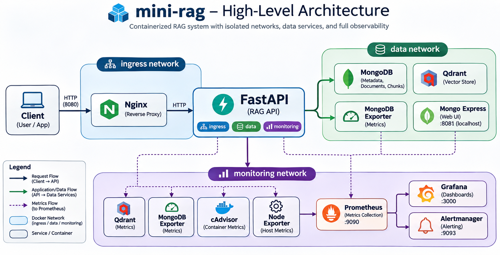
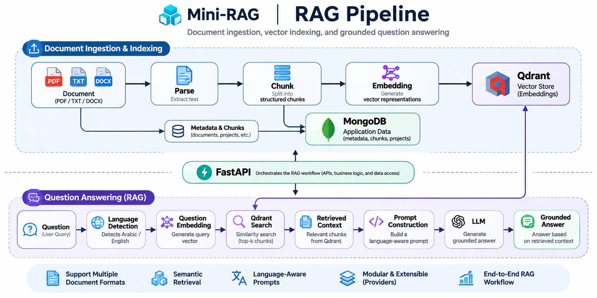
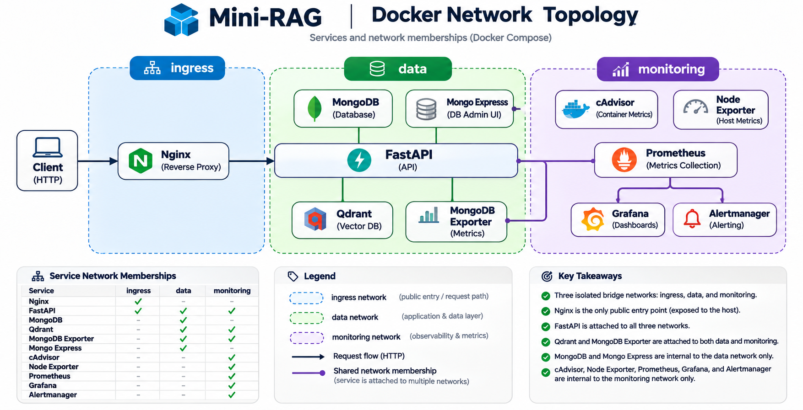
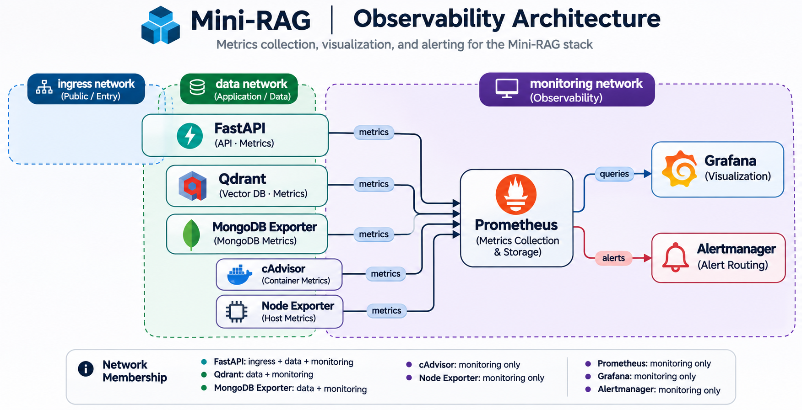

# Mini-RAG


Mini-RAG is a project-scoped Retrieval-Augmented Generation backend built with FastAPI. It ingests documents, stores project, asset, and chunk data in MongoDB, indexes embeddings in Qdrant, and answers questions using only the context retrieved from the selected project. English and Arabic questions are handled with language-specific prompts.
Mini-RAG is a project-scoped Retrieval-Augmented Generation backend built with FastAPI. It ingests documents, stores project/asset/chunk data in MongoDB, indexes embeddings in Qdrant, and answers questions using only the context retrieved from the selected project. English and Arabic questions are handled with language-specific prompts.

The repository also ships a complete local deployment: a reverse proxy, isolated Docker networks, healthchecks, Prometheus metrics, five provisioned Grafana dashboards, Prometheus alert rules, and Alertmanager. It is designed to be run with Docker Compose on a single host and to make the RAG and observability flows easy to inspect.

## Contents

- [Features](#features)
- [Tech Stack](#tech-stack)
- [Architecture](#architecture)
  - [High-Level Architecture](#high-level-architecture)
  - [RAG Pipeline](#rag-pipeline)
  - [Docker Network Architecture](#docker-network-architecture)
  - [Observability Architecture](#observability-architecture)
- [Document Ingestion & Indexing](#document-ingestion--indexing)
- [RAG Workflow](#rag-workflow)
- [API](#api)
- [Quick Start](#quick-start)
- [Ports & Services](#ports--services)
- [Configuration](#configuration)
- [Observability](#observability)
- [Persistence](#persistence)
- [Project Structure](#project-structure)
- [Design Decisions](#design-decisions)
- [Security & Production Considerations](#security--production-considerations)
- [Limitations](#limitations)
- [Testing](#testing)
- [Troubleshooting](#troubleshooting)
- [License](#license)

## Features

- **FastAPI REST API** with a consistent JSON envelope, centralized exception handling, and generated OpenAPI documentation.
- **Project-scoped ingestion** through a multipart upload endpoint; uploading to an unknown project ID creates the project automatically.
- **PDF/TXT parsing** with LangChain document loaders and PyMuPDF, followed by recursive character chunking with configurable size and overlap.
- **Asynchronous MongoDB access** using the PyMongo async client, with startup index creation for projects, assets, and chunks.
- **Qdrant vector indexing** with deterministic UUIDs, project payload filtering, startup collection validation, and a safe reset path for stale vectors.
- **Grounded RAG question answering** with top-k retrieval, deduplicated numbered context, source chunks in the response, and Arabic/English prompt templates.
- **Provider abstraction** for chat completion and embedding generation. The repository includes an OpenRouter adapter, but business logic depends on provider contracts rather than the adapter.
- **Result Pattern** across validation, services, and business logic, with explicit success/failure results and HTTP status mapping at the route boundary.
- **Prometheus metrics** for HTTP traffic and the RAG pipeline, using bounded labels instead of raw URLs, project IDs, or questions.
- **Provisioned observability** with five Grafana dashboards and fourteen Prometheus alert rules covering the API, MongoDB, Qdrant, containers, and the host.
- **Docker Compose deployment** with a multi-stage, non-root API image, healthchecks, and three isolated bridge networks.
- **Unit and integration tests** covering business logic, services, validators, API envelopes, repositories, Qdrant integration, and the end-to-end RAG flow.

> Upload validation accepts `.pdf`, `.txt`, and `.docx`. The current parser only registers PDF and TXT loaders, so DOCX files can be uploaded but cannot be processed yet. See [Limitations](#limitations).

## Tech Stack

| Category | Technology |
| --- | --- |
| Language / runtime | Python 3.12 |
| API | FastAPI 0.143.3, Uvicorn 0.54.0, Pydantic v2 / pydantic-settings 2.16.0 |
| Document processing | LangChain 1.4.6, PyMuPDF 1.28.2 (`PyMuPDFLoader`, `TextLoader`, `RecursiveCharacterTextSplitter`) |
| Application database | MongoDB 7 with the async PyMongo client |
| Vector database | Qdrant 1.20.1, `qdrant-client` 1.20.0 |
| LLM and embeddings | OpenRouter HTTP API through the application's provider contracts |
| Reverse proxy | Nginx 1.31.8-alpine |
| Metrics instrumentation | `prometheus-client` 0.26.0 |
| Metrics collection | Prometheus v3.16.0 |
| Dashboards | Grafana 13.2.6, five provisioned dashboards |
| Alerting | Alertmanager v0.35.0 |
| Container monitoring | cAdvisor v0.55.1 |
| Host monitoring | Node Exporter v1.12.1 |
| MongoDB monitoring | Percona MongoDB Exporter 0.54.0 |
| MongoDB UI | `mongo-express:latest` |
| Containerization | Docker Compose |
| Testing | pytest, httpx |
| License | MIT |

## Architecture

Mini-RAG runs as a small set of cooperating containers. The application is deliberately split from its stateful stores and from the monitoring plane so each part can be reasoned about and operated independently on a single Docker host.

### High-Level Architecture



Nginx is the public application entry point. It listens on host port `8080` and proxies requests to FastAPI at `api:8000` over the `ingress` network. The API container has no published host port. FastAPI reads and writes project, asset, and chunk data in MongoDB and uses Qdrant for vector storage and similarity search. Chat and embedding requests leave the stack over HTTPS to OpenRouter.

MongoDB and Qdrant are not public services. Qdrant is reachable from both the application data plane and the monitoring network because Prometheus scrapes its native metrics endpoint. The monitoring containers are kept on a separate network from the application database, except where a scrape target or exporter needs access to a data service.

### RAG Pipeline



The pipeline has two explicit phases:

1. **Document ingestion and indexing:** upload, validate, parse, chunk, persist chunks to MongoDB, embed chunks, and upsert vectors into Qdrant.
2. **Question answering:** validate the question, detect its language, embed it, retrieve project-scoped chunks from Qdrant, construct a grounded prompt, and call the chat model.

Document processing and vector indexing are separate API operations. This keeps chunk persistence inspectable and allows vectors to be rebuilt without reparsing the original files.

### Docker Network Architecture



The Compose stack defines three user-defined Docker bridge networks:

```text
ingress
data
monitoring
```

| Service | `ingress` | `data` | `monitoring` |
| --- | :---: | :---: | :---: |
| Nginx | ✓ | | |
| FastAPI | ✓ | ✓ | ✓ |
| MongoDB | | ✓ | |
| Qdrant | | ✓ | ✓ |
| MongoDB Exporter | | ✓ | ✓ |
| Mongo Express | | ✓ | |
| cAdvisor | | | ✓ |
| Node Exporter | | | ✓ |
| Prometheus | | | ✓ |
| Grafana | | | ✓ |
| Alertmanager | | | ✓ |

The separation limits which containers can resolve and reach each other:

- `ingress` carries client traffic from Nginx to FastAPI.
- `data` carries application traffic from FastAPI to MongoDB and Qdrant, and from the MongoDB Exporter to MongoDB.
- `monitoring` carries metrics scraping, dashboard queries, and alert delivery.

FastAPI is attached to all three networks because it serves ingress traffic, needs both data stores, and must be scraped by Prometheus. Qdrant and the MongoDB Exporter are dual-homed so they can serve the application on `data` and expose metrics on `monitoring`. MongoDB, Mongo Express, and the monitoring-only services do not share a network unless their role requires it.

These are Docker bridge networks, not encrypted overlays. They reduce reachability and make service boundaries explicit, but they are not a substitute for authentication, TLS, or host hardening.

### Observability Architecture



Prometheus pulls metrics from six targets: itself, the FastAPI application, Qdrant, the MongoDB Exporter, cAdvisor, and Node Exporter. Grafana reads from Prometheus and serves the provisioned dashboards. Prometheus sends fired alerts to Alertmanager. The application's `/metrics` endpoint is reachable only from inside the Docker networks because Nginx returns `404` for it.

The monitoring layers answer different questions:

- **Application:** request rate, status codes, latency, RAG questions, answers, errors, and stage timings.
- **Database:** MongoDB availability, connections, operations, memory, storage, and cache metrics through the MongoDB Exporter.
- **Vector database:** Qdrant collection, point, queue, optimization, CPU, and memory metrics from its native endpoint.
- **Containers and host:** cAdvisor and Node Exporter for container resource usage, restarts, and host CPU, memory, disk, and network.

## Document Ingestion & Indexing

The implemented ingestion flow is:

```text
Upload
  → validate extension and size
  → stream the file to src/assets/files/{project_id}/
  → persist asset metadata in MongoDB
  → parse PDF/TXT
  → split text into overlapping chunks
  → persist chunks in MongoDB
  → embed chunks
  → upsert vectors and payload metadata into Qdrant
```

**Upload.** `POST /api/v1/data/upload/{project_id}` accepts a multipart file in the `file` field. The endpoint validates the filename, extension, and configured maximum size, stores the file under a project-specific directory, and creates an asset record in MongoDB. The project is created automatically if it does not exist. Files are streamed to disk rather than loaded fully into memory. Nginx allows up to `12m` per request, leaving room for multipart framing around the default 10 MB application limit.

**Processing.** The processing endpoints parse an uploaded PDF or TXT file with LangChain loaders, drop documents whose text is empty, and split the result with `RecursiveCharacterTextSplitter`. The defaults are `chunk_size=100` and `overlap_size=20`; both can be supplied per request. Each chunk is written as a `DataChunk` containing the chunk text, source metadata, a one-based order, the owning project, and the owning asset. Chunks are inserted in batches of 100.

There are two processing modes:

- `POST /api/v1/data/process/{project_id}` processes one uploaded file identified by `file_id`.
- `POST /api/v1/data/process/project/{project_id}` processes every asset in the project and replaces each asset's existing chunks after the new chunks are inserted.

**Indexing.** `POST /api/v1/projects/{project_id}/vectors/index` is a separate operation. It loads all chunks for the project from MongoDB, generates an embedding for each chunk through the configured embedding provider, and upserts the vectors into Qdrant. Each vector ID is a deterministic UUID derived from the MongoDB chunk ID. The Qdrant payload contains:

```text
project_id
asset_id
chunk_id
chunk_index
text
```

A keyword payload index on `project_id` is created at startup. Search and RAG retrieval always apply a `project_id` filter.

When `do_reset` is `true`, the application records the project's existing vector IDs first, upserts the new vectors, and only then deletes IDs that are no longer part of the project. A failed embedding or upsert therefore does not trigger stale-vector deletion.

### MongoDB and Qdrant responsibilities

MongoDB is the application's source of truth for project records, asset metadata, and chunk text/metadata. Uploaded files live on the local filesystem under `src/assets`. Qdrant stores embeddings and a copy of the retrieval payload, not the original files.

```text
MongoDB
  ├── projects
  ├── assets
  └── data_chunks (text + metadata)

Qdrant
  └── document chunks (vector + retrieval payload)

src/assets/files/
  └── uploaded source files
```

No embeddings are stored in MongoDB. Qdrant is a derived index that can be rebuilt from MongoDB chunks by re-running the indexing endpoint.

## RAG Workflow

A question moves through the system as follows:

```text
Question
   → validation
   → Arabic/English language detection
   → question embedding
   → Qdrant similarity search (top 5, filtered by project_id)
   → context assembly and source extraction
   → language-specific prompt construction
   → chat completion
   → grounded answer + sources
```

1. **Validation.** The question must be non-empty and at most 4,000 characters. The project ID is also checked before retrieval.
2. **Language detection.** The application counts Arabic and Latin letters. Questions with Arabic letters and no Latin letters are Arabic; mixed text follows the dominant script; text without letters defaults to English.
3. **Retrieval.** The normalised question is embedded with the configured embedding model. Qdrant returns the top five results for the project. The context limit is fixed at five in the RAG business logic.
4. **Context construction.** Empty chunks are skipped and duplicate chunk IDs are removed. The remaining chunks are formatted as a numbered context (`[1]`, `[2]`, ...) and the same results become the response `sources`.
5. **Prompt construction.** A registered Arabic or English RAG template supplies the system instruction and user prompt. The system instruction tells the model to use only the retrieved context, ignore instructions embedded inside documents, distinguish explicit facts from inferences, and state when the context is insufficient.
6. **Generation.** The configured chat provider receives the system and user messages and returns the answer.
7. **Response.** The API returns the project ID, question, answer, language, configured model ID, and source chunks. If no chunk with usable text is found, the request fails with HTTP `422` and a no-relevant-chunks error message.

This is single-turn question answering. The current implementation does not stream tokens and does not carry conversation history between requests.

## API

Application API endpoints are under `/api/v1` and are available through Nginx at:

```text
http://localhost:8080
```

Interactive documentation:

- **Swagger UI:** `http://localhost:8080/docs`
- **ReDoc:** `http://localhost:8080/redoc`
- **OpenAPI schema:** `http://localhost:8080/openapi.json`

When running the API directly with Uvicorn, replace port `8080` with `8000`.

### Response envelope

Every `/api/v1` response uses the same envelope:

```json
{
  "is_success": true,
  "message": "Project created successfully.",
  "data": {
    "id": "665f1c2a9f1b2c3d4e5f6a7b",
    "project_id": "research-notes"
  }
}
```

Errors use the same shape with `data` set to `null`:

```json
{
  "is_success": false,
  "message": "Project was not found.",
  "data": null
}
```

The API maps validation and business-rule failures to `400`, missing resources to `404`, conflicts to `409`, oversized uploads to `413`, unprocessable requests to `422`, provider unavailability to `503`, and unexpected failures to `500`. FastAPI request-validation errors also return `422`. Internal error codes are kept inside the application; clients receive the envelope message.

### Projects

| Method | Endpoint | Description |
| --- | --- | --- |
| `POST` | `/api/v1/projects` | Create a project. Returns `201`; a duplicate `project_id` returns `409`. |
| `GET` | `/api/v1/projects/{project_id}` | Fetch a project by its application-level `project_id`. |

```bash
curl -X POST "http://localhost:8080/api/v1/projects" \
  -H "Content-Type: application/json" \
  -d '{"project_id":"research-notes"}'
```

Creating a project first is optional. Uploading to an unknown project ID creates it automatically.

### Documents and chunks

| Method | Endpoint | Description |
| --- | --- | --- |
| `POST` | `/api/v1/data/upload/{project_id}` | Upload a document as `multipart/form-data` in the `file` field. |
| `POST` | `/api/v1/data/process/{project_id}` | Parse and chunk one uploaded file. |
| `POST` | `/api/v1/data/process/project/{project_id}` | Process every asset in the project and replace its chunks. |
| `GET` | `/api/v1/data/chunks/{chunk_id}` | Fetch one chunk by its MongoDB chunk ID. |
| `GET` | `/api/v1/data/chunks/project/{project_id}` | List chunks with `page_size` (maximum 1,000) and `page_num`. |
| `DELETE` | `/api/v1/data/chunks/project/{project_id}` | Delete all chunks for a project. |

The chunk collection routes use MongoDB identifiers: `chunk_id` is a chunk ObjectId, while `{project_id}` in the chunk list/delete routes is the project's MongoDB `_id` (returned as `id` in project responses). The upload, process, vector, and RAG routes use the application-level `project_id` string.

Upload:

```bash
curl -X POST "http://localhost:8080/api/v1/data/upload/research-notes" \
  -F "file=@./paper.pdf"
```

The response contains `original_filename`, `stored_filename`, `file_id`, and `file_path`. Use the returned `file_id` for processing:

```bash
curl -X POST "http://localhost:8080/api/v1/data/process/research-notes" \
  -H "Content-Type: application/json" \
  -d '{"file_id":"<file_id>","chunk_size":100,"overlap_size":20}'
```

To process every asset in a project with the default chunk settings:

```bash
curl -X POST "http://localhost:8080/api/v1/data/process/project/research-notes" \
  -H "Content-Type: application/json" \
  -d '{}'
```

Processing returns the project ID, asset ID, file ID, success flag, and total chunks. The project-wide variant also returns per-asset outcomes and processed/failed counts.

### Vector indexing and search

| Method | Endpoint | Description |
| --- | --- | --- |
| `POST` | `/api/v1/projects/{project_id}/vectors/index` | Embed all project chunks and upsert them into Qdrant. |
| `POST` | `/api/v1/projects/{project_id}/vectors/search` | Run a project-filtered similarity search. |

Index the project:

```bash
curl -X POST "http://localhost:8080/api/v1/projects/research-notes/vectors/index" \
  -H "Content-Type: application/json" \
  -d '{"do_reset":true}'
```

`do_reset` is optional and defaults to `false`. When enabled, stale vectors are removed only after the new vectors have been stored successfully. Indexing a project with no chunks returns `422`.

Search:

```bash
curl -X POST "http://localhost:8080/api/v1/projects/research-notes/vectors/search" \
  -H "Content-Type: application/json" \
  -d '{"query":"What is dependency injection?","limit":5}'
```

The search response contains `chunk_id`, `project_id`, `asset_id`, `chunk_index`, `text`, and `score` for each matching chunk. Results are always filtered by the requested project; `limit` defaults to `5` and is capped at `100`.

### RAG

| Method | Endpoint | Description |
| --- | --- | --- |
| `POST` | `/api/v1/projects/{project_id}/rag/answer` | Answer a question using the project's indexed chunks. |

```bash
curl -X POST "http://localhost:8080/api/v1/projects/research-notes/rag/answer" \
  -H "Content-Type: application/json" \
  -d '{"question":"What are the main findings?"}'
```

Example response:

```json
{
  "is_success": true,
  "message": "RAG answer generated successfully.",
  "data": {
    "project_id": "research-notes",
    "question": "What are the main findings?",
    "answer": "The documents report three main findings: ...",
    "language": "en",
    "model": "nvidia/nemotron-3.5-lightning:free",
    "sources": [
      {
        "chunk_id": "665f1c2a9f1b2c3d4e5f6a7b",
        "project_id": "research-notes",
        "asset_id": "665f1c2a9f1b2c3d4e5f6a7c",
        "chunk_index": 3,
        "text": "The study reports three main findings ...",
        "score": 0.87
      }
    ]
  }
}
```

If Qdrant returns no usable text for the project, the endpoint returns `422` with a no-relevant-chunks error message. The answer is generated from the retrieved context only; the model is instructed not to use outside knowledge.

### Diagnostics and health

| Method | Endpoint | Description |
| --- | --- | --- |
| `GET` | `/api/v1/` | Return the configured application name and version. |
| `GET` | `/healthz` | Nginx liveness endpoint. Returns plain text `ok`; it does not check the API. |
| `GET` | `/metrics` | Prometheus exposition. Blocked by Nginx with `404`; scraped internally. |
| `POST` | `/api/v1/llm/test/chat` | Manual chat-provider test. Disabled by default. |
| `POST` | `/api/v1/llm/test/embeddings` | Manual embedding-provider test. Disabled by default. |

The two LLM diagnostic endpoints make real provider calls. Enable them with `LLM_TEST_ENDPOINTS_ENABLED=true` and restart the API. They are intended for credential and model checks from Swagger, not for application traffic.

The approved diagnostic models are:

- **Chat:** `liquid/lfm-2.5-2.6b:free`, `nvidia/nemotron-3.5-lightning:free`
- **Embeddings:** `nvidia/nemotron-3.5-embed-1b:free`, `liquid/lfm-2.5-embedding-350m:free`

The application's normal RAG and vector flows use `CHAT_MODEL` and `EMBEDDING_MODEL` from the environment. The allowlist above applies to the diagnostic endpoints.

## Quick Start

### Prerequisites

- Docker Engine or Docker Desktop with the Compose v2 plugin (`docker compose`).
- An OpenRouter API key for real embedding and chat calls.
- Python 3.12 if you want to run the API directly instead of using Docker.

### 1. Configure the environment

From the repository root:

```bash
cp .env.example .env
```

On Windows PowerShell:

```powershell
Copy-Item .env.example .env
```

Set at least:

- `OPENROUTER_API_KEY`
- `MONGO_ROOT_USERNAME` and `MONGO_ROOT_PASSWORD`
- `MONGO_EXPRESS_USERNAME` and `MONGO_EXPRESS_PASSWORD`
- `GRAFANA_ADMIN_USER` and `GRAFANA_ADMIN_PASSWORD`

Use `.env.example` as the source of truth. The real `.env` file is Git-ignored and must not be committed. There is no separate `docker/.env`; Compose and the API both read the root `.env`.

Compose overrides `MONGODB_URI` and `QDRANT_URL` for the API container with the internal service addresses. The localhost values in `.env` are used when the API runs directly on the host. For host development, keep the password inside `MONGODB_URI` in sync with `MONGO_ROOT_PASSWORD`.

`MONGO_ROOT_*` values are applied only when the MongoDB data directory is initialised for the first time. Changing them later does not update an existing MongoDB user.

### 2. Build and start

```bash
docker compose up -d --build
```

The first startup can take several minutes. MongoDB may replay its journal, and Grafana creates its internal database and applies migrations. Compose starts MongoDB and Qdrant before the API, waits for the API healthcheck before starting Nginx, and waits for Prometheus before starting Grafana.

### 3. Verify

```bash
docker compose ps
curl http://localhost:8080/healthz
curl http://localhost:8080/api/v1/
```

Services with healthchecks should report `healthy`. The first request returns plain text `ok`; the second returns the standard JSON envelope with the application name and version. Then open:

- **Swagger UI:** `http://localhost:8080/docs`
- **Grafana:** `http://127.0.0.1:3000`
- **Prometheus:** `http://127.0.0.1:9090`
- **Mongo Express:** `http://127.0.0.1:8081`
- **Alertmanager:** `http://127.0.0.1:9093`

`curl -i http://localhost:8080/metrics` returns `404` by design. Prometheus scrapes the API directly over the monitoring network.

### 4. Stop

```bash
docker compose down
```

This removes the containers and the `ingress`, `data`, and `monitoring` networks. It keeps the bind-mounted MongoDB, Qdrant, and upload data plus the named monitoring volumes. To remove the named monitoring volumes as well:

```bash
docker compose down -v
```

`docker compose down -v` does not delete the bind-mounted data under `docker/mongodb`, `docker/qdrant`, or `src/assets`.

### Local development

Start only the stateful services if you want to run FastAPI on the host:

```bash
docker compose up -d mongodb qdrant
```

Create a virtual environment and install the development dependencies:

```bash
python -m venv .venv
```

Activate it:

```bash
# Linux or macOS
source .venv/bin/activate

# Windows PowerShell
.venv\Scripts\Activate.ps1
```

Install dependencies and start Uvicorn:

```bash
python -m pip install --upgrade pip
python -m pip install -r requirements-dev.txt
python -m uvicorn main:app --reload --host 0.0.0.0 --port 8000
```

The host-run API uses the localhost `MONGODB_URI` and `QDRANT_URL` values from `.env`. It connects to both services during startup and ensures the configured Qdrant collections exist; if either service is unavailable, startup fails.

Local URLs:

- API base: `http://localhost:8000`
- Swagger UI: `http://localhost:8000/docs`
- Metrics: `http://localhost:8000/metrics`

`--reload` is for local development only. The Docker image runs one Uvicorn worker with proxy headers enabled.

## Ports & Services

| Service | Host binding | Container port | Purpose |
| --- | --- | ---: | --- |
| Nginx | `0.0.0.0:${NGINX_PORT:-8080}` | `80` | Public API entry point, Swagger UI, Nginx `/healthz`. |
| MongoDB | `127.0.0.1:${MONGO_HOST_PORT:-27007}` | `27017` | Optional direct database access. |
| Qdrant REST | `127.0.0.1:${QDRANT_HTTP_PORT:-6333}` | `6333` | Qdrant API and native metrics endpoint. |
| Qdrant gRPC | `127.0.0.1:${QDRANT_GRPC_PORT:-6334}` | `6334` | Qdrant gRPC endpoint. |
| Mongo Express | `127.0.0.1:${MONGO_EXPRESS_PORT:-8081}` | `8081` | MongoDB administration UI. |
| Prometheus | `127.0.0.1:${PROMETHEUS_PORT:-9090}` | `9090` | Metrics queries, targets, and rule status. |
| Grafana | `127.0.0.1:${GRAFANA_PORT:-3000}` | `3000` | Provisioned dashboards. |
| Alertmanager | `127.0.0.1:${ALERTMANAGER_PORT:-9093}` | `9093` | Alert routing and alert UI. |

Internal-only services:

| Service | Container port | Purpose |
| --- | ---: | --- |
| FastAPI | `8000` | Proxied by Nginx; no host port mapping. |
| MongoDB Exporter | `9216` | Prometheus metrics for MongoDB. |
| cAdvisor | `8080` | Prometheus metrics for containers. |
| Node Exporter | `9100` | Prometheus metrics for the Docker host / Linux VM. |

Only Nginx binds to all host interfaces. Database ports and administrative UIs are published on `127.0.0.1`, so they are reachable from the Docker host but not directly from other machines on the network. Host ports can be changed in `.env`; container ports and internal DNS names remain fixed.

Prometheus scrapes container DNS names such as `api:8000` and `qdrant:6333`, not the host port mappings.

## Configuration

The application uses Pydantic settings backed by environment variables and the root `.env` file. Compose also reads the same file for interpolation and passes it to the API container.

### Application and storage

| Variable | Default / example | Purpose |
| --- | --- | --- |
| `APP_NAME` | `Mini-RAG` | Name returned by `GET /api/v1/`. |
| `APP_VERSION` | `0.1.0` | Version returned by `GET /api/v1/`. |
| `MONGODB_URI` | localhost URI in `.env.example` | MongoDB connection string for host execution. Required by the settings model. Compose overrides it for the API container. |
| `MONGODB_DATABASE` | `mini_rag` | MongoDB database used by the application. |
| `FILE_ALLOWED_TYPES` | `[".pdf",".txt",".docx"]` | Extensions accepted by upload validation. Parsing currently supports PDF and TXT. |
| `FILE_MAX_SIZE` | `10` | Maximum upload size in megabytes. |
| `FILE_DEFAULT_CHUNK_SIZE` | `512000` | Upload streaming buffer size in bytes. This is not the text-splitter chunk size; processing defaults are `100`/`20`. |

### LLM and embeddings

| Variable | Default / example | Purpose |
| --- | --- | --- |
| `OPENROUTER_API_KEY` | empty | API key used by the OpenRouter adapter. Required for real embedding and chat calls. |
| `CHAT_PROVIDER` | `openrouter` | Registered chat-provider builder. |
| `CHAT_MODEL` | `nvidia/nemotron-3.5-lightning:free` | Chat model used by RAG. |
| `EMBEDDING_PROVIDER` | `openrouter` | Registered embedding-provider builder. |
| `EMBEDDING_MODEL` | `nvidia/nemotron-3.5-embed-1b:free` | Embedding model used for indexing and query retrieval. |
| `LLM_CONNECT_TIMEOUT` | `10` | Provider connection timeout in seconds. |
| `LLM_READ_TIMEOUT` | `60` | Provider read/write timeout in seconds. |
| `LLM_TEST_ENDPOINTS_ENABLED` | `false` | Enables the two manual LLM diagnostic endpoints. |

Provider selection is separate from model selection. The repository registers one adapter, `openrouter`, for both chat and embeddings. To add another provider, implement the `ChatProvider` and/or `EmbeddingProvider` contract under `src/llm/`, add its configuration, and register its builder in `src/llm/providers/provider_registry.py`.

### Vector database

| Variable | Default / example | Purpose |
| --- | --- | --- |
| `VECTOR_DB_PROVIDER` | `qdrant` | Registered vector database provider. |
| `VECTOR_DB_COLLECTIONS` | JSON array | Collections created or validated at startup; each has a name, dimension, and distance metric. |
| `VECTOR_DB_COLLECTION` | first configured collection | Active collection for indexing and search. Must match the embedding model's dimension. |
| `QDRANT_URL` | `http://localhost:6333` | Qdrant endpoint for host execution. Compose uses `http://qdrant:6333`. |
| `QDRANT_API_KEY` | empty | Optional Qdrant API key. |
| `QDRANT_TIMEOUT` | `30` | Qdrant request timeout in seconds. |

The example `.env` configures two cosine collections:

```text
document_chunks_nemotron_1b   dimension 2048
document_chunks_lfm_350m      dimension 1024
```

The active collection must use the same embedding space as the configured embedding model. If you switch models, switch to the matching collection and re-index the project. The application validates existing collection dimensions and distance metrics at startup and fails if they do not match the configuration.

### Docker Compose credentials

| Variable | Purpose |
| --- | --- |
| `MONGO_ROOT_USERNAME` | MongoDB root user, applied when the data directory is first initialised. |
| `MONGO_ROOT_PASSWORD` | MongoDB root password, applied at the same point. |
| `MONGO_EXPRESS_USERNAME` | Basic-auth username for Mongo Express. |
| `MONGO_EXPRESS_PASSWORD` | Basic-auth password for Mongo Express. |
| `GRAFANA_ADMIN_USER` | Grafana administrator username. |
| `GRAFANA_ADMIN_PASSWORD` | Grafana administrator password, applied when the Grafana volume is first initialised. |

Replace every placeholder in `.env` before the first start. Grafana credentials can be rotated later in the Grafana UI; changing `GRAFANA_ADMIN_PASSWORD` alone does not update an existing Grafana database. Host port overrides are listed in [Ports & Services](#ports--services).

## Observability

The monitoring stack is provisioned automatically. No datasource or dashboard import is required.

### Application metrics

The API exposes Prometheus metrics at `/metrics`:

| Metric | Type | Labels | Meaning |
| --- | --- | --- | --- |
| `http_requests_total` | Counter | `method`, `route`, `status` | HTTP requests handled by FastAPI. |
| `http_request_duration_seconds` | Histogram | `method`, `route` | HTTP request latency. |
| `rag_questions_total` | Counter | `language` | Valid questions accepted by the RAG pipeline. |
| `rag_answers_generated_total` | Counter | `language` | RAG answers generated successfully. |
| `rag_no_relevant_chunks_total` | Counter | `language` | RAG requests with no usable context. |
| `rag_errors_total` | Counter | `stage` | Pipeline failures by stage: `validation`, `vector_search`, `context`, `prompt`, or `llm`. |
| `rag_pipeline_duration_seconds` | Histogram | — | End-to-end RAG pipeline latency. |
| `rag_embedding_duration_seconds` | Histogram | `operation` | Question-embedding latency. |
| `rag_vector_search_duration_seconds` | Histogram | `operation` | Qdrant search latency. |
| `rag_llm_duration_seconds` | Histogram | — | Chat-completion latency. |

Labels are deliberately bounded. HTTP metrics use the method, the FastAPI route template (for example `/api/v1/projects/{project_id}/rag/answer`), and the status code; unknown routes become `unmatched`, and unrecognised methods become `OTHER`. The middleware skips `/metrics` itself. RAG metrics use only `language` and pipeline `stage`; project IDs, document IDs, questions, and raw URL paths are never used as labels.

The embedding histogram covers the query-embedding step. Document-indexing embedding calls are not instrumented with the same histogram.

`/metrics` is not exposed through Nginx. A request to `http://localhost:8080/metrics` returns `404`; Prometheus scrapes `api:8000/metrics` over the `monitoring` network.

### Scrape targets

Prometheus uses a 15-second global scrape interval and evaluation interval, a 10-second scrape timeout, and 15-day retention. The configured targets are:

| Job | Target | Notes |
| --- | --- | --- |
| `prometheus` | `localhost:9090` | Self-scrape. |
| `api` | `api:8000/metrics` | FastAPI application metrics. |
| `qdrant` | `qdrant:6333/metrics` | Qdrant native metrics. |
| `mongodb` | `mongodb-exporter:9216/metrics` | MongoDB metrics. |
| `cadvisor` | `cadvisor:8080/metrics` | Container metrics; scraped every 30 seconds. |
| `node-exporter` | `node-exporter:9100/metrics` | Host / Docker VM metrics. |

Check target health at `http://127.0.0.1:9090/targets` or query the Prometheus API:

```bash
curl "http://127.0.0.1:9090/api/v1/targets?state=active"
```

### Grafana dashboards

Grafana is provisioned with five dashboards in the `Mini-RAG` folder:

| Dashboard | Coverage |
| --- | --- |
| `Mini-RAG - API` | Request rate, status codes, routes, methods, 5xx ratio, and latency quantiles. |
| `Mini-RAG - RAG` | Request and answer counts, languages, no-context responses, pipeline errors, and stage latency. |
| `Mini-RAG - MongoDB` | Availability, connections, operation counters, document operations, memory, storage, WiredTiger cache, and network throughput. |
| `Mini-RAG - Qdrant` | Collections, points/vectors, CPU, memory, update queues, optimizations, recovery mode, and snapshot activity. |
| `Mini-RAG - Infrastructure` | Host CPU, memory, filesystem, and network, plus container CPU, memory, network, filesystem I/O, restarts, and unavailable containers. |

The Prometheus datasource and dashboards are provisioned from `docker/grafana/provisioning/` and `docker/grafana/dashboards/`. The datasource points to `http://prometheus:9090`; dashboards are read-only by default.

### Alerting

Prometheus loads rules from `docker/prometheus/rules/` and sends them to Alertmanager at `alertmanager:9093`. The provisioned rules cover:

- **API:** target down, target missing, 5xx rate above 5% for 5 minutes, and p95 latency above 5 seconds for 5 minutes.
- **Databases:** MongoDB down, MongoDB Exporter down, and Qdrant down.
- **Host:** CPU above 85% for 10 minutes, memory above 90% for 10 minutes, free disk below 15% for 10 minutes, and Node Exporter down.
- **Containers:** unavailable container, container restart, and cAdvisor down.

Alertmanager starts with a default receiver that has no notifier. Alerts are visible in the Alertmanager UI at `http://127.0.0.1:9093`, but no email, Slack, or webhook messages are sent. `docker/alertmanager/alertmanager.yml` includes commented webhook and email receiver examples; uncomment one, replace the placeholders, and point `route.receiver` at it to enable external delivery.

### Single-worker metrics

The API image runs one Uvicorn worker:

```text
uvicorn main:app --host 0.0.0.0 --port 8000 --workers 1 --proxy-headers --forwarded-allow-ips=*
```

`prometheus-client` stores counters and histograms in process memory. With multiple workers or replicas, each process exposes its own values and Prometheus scrapes would alternate between them. Horizontal scaling requires either one API container per Prometheus target or the client's multiprocess mode with a shared `PROMETHEUS_MULTIPROC_DIR` and a multiprocess-aware exposition endpoint.

## Persistence

| Data | Backing store | Notes |
| --- | --- | --- |
| MongoDB database | `./docker/mongodb` bind mount | `/data/db` in the container. Initialised with `MONGO_ROOT_*` only when empty. |
| Qdrant collections | `./docker/qdrant` bind mount | `/qdrant/storage` in the container. |
| Uploaded files | `./src/assets` bind mount | `/app/src/assets` in the container; files live under `files/{project_id}/`. |
| Prometheus data | `prometheus_data` named volume | 15-day retention configured in Compose. |
| Grafana data | `grafana_data` named volume | Dashboards are provisioned; Grafana state and users live here. |
| Alertmanager data | `alertmanager_data` named volume | Silence and notification state. |

Bind mounts are host directories. They survive `docker compose down` and `docker compose down -v`. Named volumes are managed by Docker and are removed by `docker compose down -v`.

The MongoDB, Qdrant, and upload directories are not application source code. They are excluded from Git by `docker/.gitignore` and `src/assets/.gitIgnore`. Back up the three bind-mounted directories before moving the project, changing permissions, or rebuilding the host. The repository does not include automated backups.

MongoDB indexes are created during application startup: a unique index on `projects.project_id`, an index on `data_chunks.chunk_project_id`, and project/name/date indexes for assets.

## Project Structure

```text
Mini-RAG/
├── src/
│   ├── api/                  # API envelope serialization and exception handlers
│   ├── business_logic/       # Project, asset, chunk, vector, and RAG use cases
│   ├── constants/            # Error codes, messages, and success messages
│   ├── db/                   # Async MongoDB lifespan and index creation
│   ├── dependencies/         # FastAPI dependency wiring
│   ├── dtos/                 # Request and response models
│   ├── enums/                # Processing and language enums
│   ├── helpers/              # Settings and the Result Pattern
│   ├── llm/
│   │   ├── contracts/        # ChatProvider and EmbeddingProvider interfaces
│   │   ├── factories/        # Provider factories
│   │   ├── providers/        # OpenRouter adapter and provider registry
│   │   └── templates/        # English and Arabic RAG prompts
│   ├── models/               # Project, Asset, and DataChunk documents
│   ├── observability/        # Prometheus metrics and HTTP middleware
│   ├── repositories/         # MongoDB persistence layer
│   ├── routes/               # HTTP routes, including /metrics
│   ├── services/             # Upload, parsing, chunking, language, and context
│   ├── validators/           # Upload, process, and RAG validation
│   ├── vector_db/            # Vector contracts, models, factory, Qdrant adapter
│   └── assets/               # Uploaded files at runtime (bind-mounted)
├── tests/
│   ├── unit/                 # Business logic, services, validators, helpers
│   ├── integration/          # API, repositories, vectors, and RAG flows
│   └── support/              # Isolated MongoDB/Qdrant test helpers
├── docker/
│   ├── alertmanager/         # Alertmanager configuration
│   ├── grafana/
│   │   ├── dashboards/       # Five provisioned dashboards
│   │   └── provisioning/     # Prometheus datasource and dashboard provider
│   ├── nginx/                # Reverse proxy configuration
│   └── prometheus/
│       ├── prometheus.yml    # Scrape configuration
│       └── rules/            # API, database, container, host alert rules
├── docs/
│   └── architecture/         # Four architecture images used in this README
├── Dockerfile
├── docker-compose.yml
├── .dockerignore
├── .env.example
├── main.py
├── pytest.ini
├── requirements.txt
├── requirements-dev.txt
├── LICENSE
└── README.md
```

Responsibilities at a glance:

- `src/api`: standard response construction and exception handling.
- `src/business_logic`: application use cases and orchestration.
- `src/repositories`: MongoDB access.
- `src/services`: file upload, parsing, chunking, language detection, and context building.
- `src/llm`: provider contracts, factories, the OpenRouter adapter, and prompt templates.
- `src/vector_db`: provider-independent vector contracts, Qdrant implementation, and lifecycle management.
- `src/observability`: metric definitions and the ASGI middleware.
- `docker/`: Nginx, Prometheus, Alertmanager, and Grafana configuration.
- `tests/`: unit and integration suites.

## Design Decisions

### MongoDB for application data, Qdrant for vectors

MongoDB holds the durable application records: projects, asset metadata, and chunk text with source metadata. Qdrant holds embeddings plus the payload needed for retrieval and response construction. This keeps document metadata queryable without a vector database and keeps similarity search out of MongoDB. Qdrant is a derived index, so re-indexing can rebuild it from MongoDB chunks.

### Explicit ingestion and indexing phases

Parsing/chunking and embedding/indexing are separate API calls. This makes it possible to inspect persisted chunks before incurring embedding costs, to reprocess documents without losing the previous vector set, and to retry indexing independently of file parsing. The trade-off is that callers must remember to index after processing; vector indexing is not triggered automatically.

### Deterministic vector IDs and safe resets

Vector IDs are UUID5 values derived from MongoDB chunk IDs. Re-indexing the same chunk updates the same Qdrant point instead of creating a duplicate. When `do_reset` is enabled, stale IDs are removed only after the new vectors are successfully stored, preserving the previous index if an embedding call fails.

### Provider contracts and factories

Business logic depends on `ChatProvider` and `EmbeddingProvider` interfaces rather than OpenRouter. Factories select a registered provider builder from configuration. OpenRouter is the only adapter currently registered, but the boundary keeps provider-specific HTTP, model IDs, and credentials out of the RAG flow.

### Result Pattern at the route boundary

Expected failures are represented as `Result` values with an error type, message, and internal code. Business logic returns those values instead of raising for normal validation or business failures; routes translate them into the shared HTTP envelope. The exception handlers cover FastAPI request validation and unexpected exceptions, so client responses remain consistent.

### Project-scoped retrieval

Every vector carries a `project_id` payload, Qdrant has a keyword payload index on that field, and search always applies a project filter. RAG inherits the same scope and returns sources exclusively from the selected project. Project scoping is an application-level data boundary; it is not authentication or authorisation.

### Network segmentation and bounded metrics

The `ingress`, `data`, and `monitoring` networks make the intended traffic paths explicit: only Nginx is public, application data services are not on the monitoring network unless they expose metrics, and the API exposes its metrics to Prometheus over the monitoring network. Metrics use bounded labels so cardinality stays predictable and the application never uses raw questions, project IDs, or URLs as label values.

## Security & Production Considerations

- **Secrets:** credentials are supplied through environment variables and `.env`. The real `.env` is Git-ignored. Replace every placeholder before starting; do not reuse the example values.
- **Public surface:** Nginx is the only service bound to all host interfaces. The API has no host port, and MongoDB, Qdrant, Mongo Express, Prometheus, Grafana, and Alertmanager are published on `127.0.0.1` only. `/metrics` is explicitly blocked by Nginx.
- **No API authentication:** the application has no authentication or authorization layer. Project IDs are not access-control boundaries. Do not expose port `8080` directly to an untrusted network.
- **No TLS:** Nginx serves plain HTTP on port 80 and Compose publishes it as HTTP on `8080`. Terminate TLS at a trusted ingress or reverse proxy before exposing the stack beyond localhost.
- **No rate limiting:** Nginx does not apply request rate limits. The API relies on size validation and provider-side limits, not an application quota.
- **Admin interfaces:** Mongo Express has basic authentication enabled and is configured with MongoDB admin access. Grafana disables anonymous access and user sign-up. Prometheus and Alertmanager have no authentication in this configuration and are localhost-bound.
- **Host-level monitoring:** cAdvisor runs with `privileged: true` and mounts `/`, `/var/run`, `/sys`, `/var/lib/docker`, and `/dev/disk` read-only. Node Exporter mounts `/` at `/host` read-only. These containers can observe host and Docker internals; restrict access to the Docker host and monitoring network.
- **Network isolation:** the bridge networks control container reachability but do not encrypt traffic. Any container that shares two networks can bridge them, so network membership is not a substitute for service hardening.
- **Availability and data:** the stack is a single-host Compose deployment with one API worker. It has no high-availability configuration, no automated backups, no retry/fallback for provider calls, and no external alert notifier.
- **Production readiness:** this repository is a complete local deployment and reference implementation, not a hardened multi-tenant production platform. Treat the limitations below as deployment prerequisites rather than optional polish.

## Limitations

| Area | Current limitation |
| --- | --- |
| Deployment | Single-host Docker Compose; one API worker. No Kubernetes, cloud deployment configuration, CI/CD workflow, or high-availability setup is included. |
| Security | No API authentication, TLS, or rate limiting. The service is intended for local or trusted-network use. |
| Document formats | Upload validation accepts `.docx`, but only PDF and TXT parsers are implemented. DOCX processing returns an unsupported-file error. |
| Retrieval quality | Top-5 vector results are used without a similarity threshold, reranking, hybrid search, or query expansion. |
| Vector lifecycle | Deleting chunks through the API does not delete the corresponding Qdrant vectors. Re-index with `do_reset` while chunks exist, or clean the collection manually. |
| Embedding cost | Indexing embeds chunks one at a time through the provider API. Large projects can be slow and consume significant provider quota. |
| Provider dependency | Real indexing, search, and RAG require a working OpenRouter key. The application does not retry, back off, or fall back to another model/provider. |
| Alert delivery | Alertmanager has no active notifier, so alerts are only visible in its UI. |
| Monitoring | Application metrics are process-local and assume one worker. Qdrant metrics cover its native collection/process data; application request latency is tracked by the API and RAG dashboards. On Docker Desktop for Windows, host metrics describe the Linux VM rather than native Windows. |
| Tests | There is no CI pipeline or coverage threshold. Integration tests skip when MongoDB or Qdrant is unavailable. |
| Conversation | RAG is single-turn; there is no streaming, chat history, or conversational memory. |

## Testing

The project uses pytest. Unit tests cover business logic, services, validators, helpers, vector models, provider factories, and prompt templates. Integration tests cover API envelopes, upload/process endpoints, repositories, Qdrant vector flows, and the end-to-end RAG flow.

Install the development dependencies:

```bash
python -m pip install -r requirements-dev.txt
```

Run all tests:

```bash
python -m pytest -q
```

Run unit tests only:

```bash
python -m pytest -q -m "not integration"
```

Run integration tests only:

```bash
python -m pytest -q -m integration
```

Integration tests use the configured `MONGODB_URI` and `QDRANT_URL`. Repository tests create isolated `mini_rag_test_<uuid>` databases and remove them afterwards. Vector tests create isolated Qdrant collections and clean them up. If MongoDB or Qdrant is unreachable, the relevant integration tests are skipped rather than failed.

Point the integration configuration at a dedicated development or test instance. Do not run destructive integration tests against production data. A successful run exits with status code `0`; no coverage percentage or coverage threshold is configured in the repository.

## Troubleshooting

### Containers are still starting

MongoDB can take several minutes to replay its journal on a bind mount, and Grafana can take several minutes on first start while it creates its database. Check progress with:

```bash
docker compose ps
docker compose logs -f mongodb
docker compose logs -f grafana
```

Do not delete `docker/mongodb` just because the first startup is slow.

### MongoDB authentication fails after changing credentials

`MONGO_ROOT_*` only initialises a new data directory. If `docker/mongodb` already exists, changing `.env` does not change the existing MongoDB user. Restore the previous credentials, update the user explicitly in MongoDB, or back up and deliberately reset the data directory.

### A host port is already in use

Change the corresponding variable in `.env` and recreate the affected containers:

```dotenv
NGINX_PORT=8090
PROMETHEUS_PORT=9091
```

```bash
docker compose up -d
```

### `/metrics` returns 404 from port 8080

This is intentional. Nginx blocks `/metrics`; Prometheus scrapes `api:8000/metrics` over the monitoring network. For local debugging, read the endpoint from inside the API container:

```bash
docker compose exec api python -c "import urllib.request; print(urllib.request.urlopen('http://127.0.0.1:8000/metrics').read().decode())"
```

### Prometheus has a down target or Grafana has no data

- Confirm Prometheus is ready: `curl http://127.0.0.1:9090/-/ready`.
- Open `http://127.0.0.1:9090/targets` and check the `api`, `qdrant`, `mongodb`, `cadvisor`, and `node-exporter` jobs.
- Confirm the Grafana datasource points to `http://prometheus:9090`.
- Generate a small amount of API traffic so rate-based panels have samples.

### Qdrant collection validation fails at startup

The active `VECTOR_DB_COLLECTION` must have the same dimension and distance metric as the configured embedding model's collection. Align `VECTOR_DB_COLLECTION` with `EMBEDDING_MODEL`, or back up and recreate the collection if its configuration is wrong. Then re-index the project.

### Alertmanager sends no notifications

The default configuration has a null receiver and ships with commented receiver examples. Add and configure a receiver if you want external notifications.

### LLM provider errors

The application maps provider failures to the HTTP envelope. Common internal codes are:

- `llm_api_key_missing`: set `OPENROUTER_API_KEY` in `.env`.
- `llm_auth_failed`: verify that the key is valid and active.
- `llm_rate_limited`: the provider or free-tier limit was reached; wait and retry. The application does not retry automatically.
- `llm_timeout` / `llm_provider_error`: retry or check OpenRouter availability.
- `llm_invalid_response`: the provider returned no usable text or vector; retry or select the other approved diagnostic model.

### Integration tests are skipped

The integration fixtures skip when the configured MongoDB or Qdrant instance is unreachable. Start the data services with `docker compose up -d mongodb qdrant`, confirm the host URLs in `.env`, and rerun the tests.

### Docker Desktop on Windows and WSL

Node Exporter and cAdvisor run inside the Docker Desktop Linux VM, not on native Windows. Host CPU, memory, load, and network panels therefore describe the Docker Desktop VM. Qdrant data on Windows bind mounts can also be slower than on a Linux filesystem; keep the data directories on a local disk and allow extra time for first startup and indexing.

## License

This project is licensed under the MIT License. See the [LICENSE](LICENSE) file for the full text.
